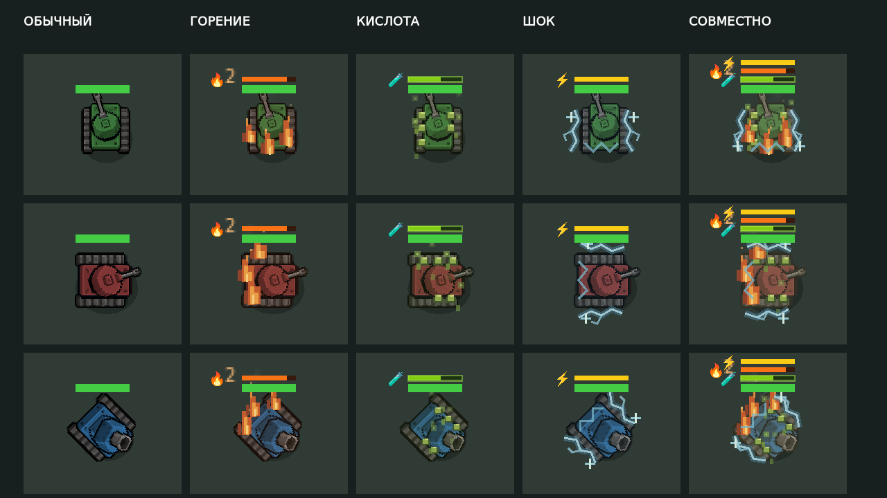

# Tank status artwork

Burning, acid and shock/stun now have separate animated pixel effects on tanks,
in addition to their existing duration/stack indicators. Team paint and the gun
remain readable through low-opacity armor tints and an open center.

- Burning: stepped orange/gold flames along the tracks and engine, embers and
  small smoke clusters behind the hull. More burn stacks add flame coverage.
- Acid: olive/lime deposits, downward drips and rising square bubbles. Coverage
  increases with acid stacks.
- Shock: pale blue angular arcs along the tracks and rear armor, small forks and
  sparks. Reduced flashes attenuate the outer glow.

`TankStatusFx` is shared by sprite and geometric tank rendering. Anchors follow
the chassis rotation; flames rise toward the top of the screen. Effects scale
with tank size and use simulation ticks, so they stop animating when paused.
They do not create persistent particles or change health, damage, timers or
gameplay randomness. Status expiry and death remove the effect immediately.
The normal stealth visibility checks run before the tank and its status artwork
are drawn. Low FX quality retains the combat cues with fewer small details.

The existing `stun_ticks` state is shared by electric hits and other stuns;
the new electric/stun artwork uses this same state without adding a new mechanic.

Validation, from repository root, Godot 4.7:

```sh
godot --headless --path godot tests/special_cannons_check.tscn
godot --path godot tests/tank_status_visual_check.tscn
```

The visual check requires a graphics display (X11/Xvfb works on Linux). It tests
animation, paused frames, expiry, concurrent statuses, stack intensity, reduced
flashes, low quality, death, rotation and unchanged health/timers.

Open `godot/tests/tank_status_preview.tscn` and press F6 for an animated comparison
on several chassis and colors. To save a frame to `user://tank_status/` and exit:

```sh
godot --path godot tests/tank_status_preview.tscn -- --capture-status
```


